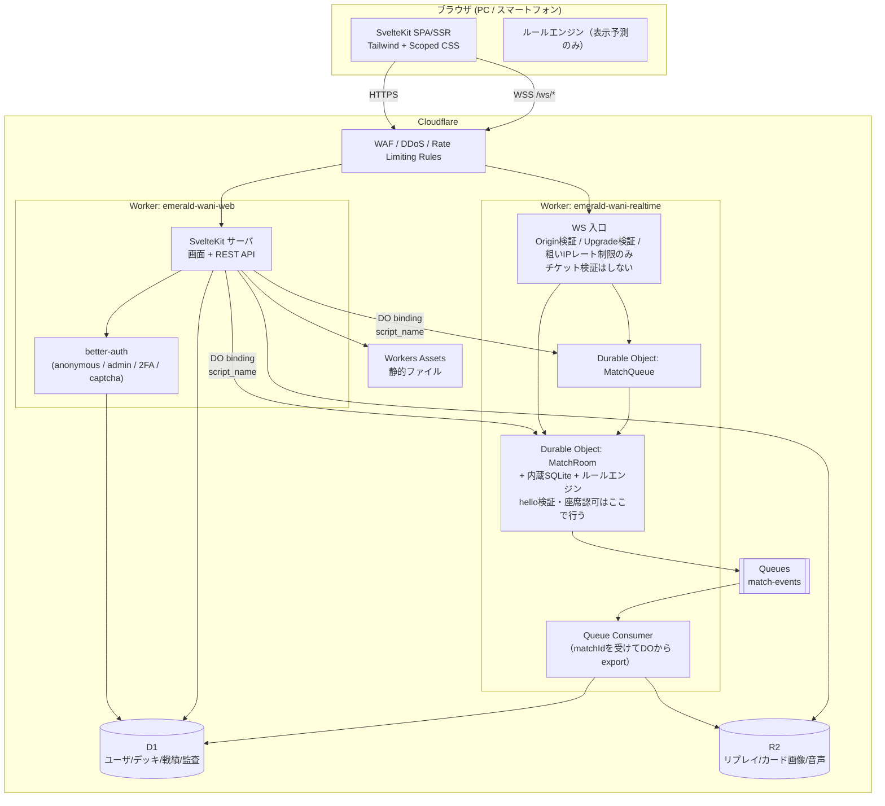
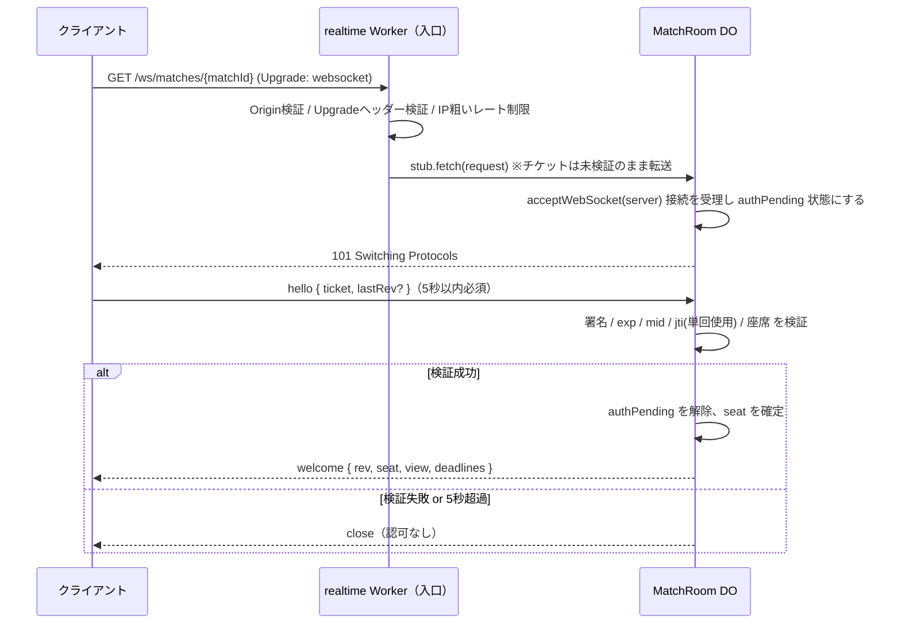

# システム構成

> [設計ドキュメント索引](./README.md)

### 3.1 全体図



### 3.2 なぜ 2 Worker に分割するのか

SvelteKit（`@sveltejs/adapter-cloudflare`）のローカル開発は `platformProxy`（内部的に `getPlatformProxy`）でバインディングをエミュレートする。ここには Cloudflare 公式ドキュメントに明記された制約がある。

> To use a Durable Object binding with `getPlatformProxy`, always specify a `script_name`.
> You will need to declare your Durable Object in another Worker.
> — [Wrangler API ドキュメント](https://developers.cloudflare.com/workers/wrangler/api/)

つまり **SvelteKit アプリと同じ Worker 内で定義した DO はローカル開発でバインドできない**。Docker を使わずに本番同等の DO をローカルで動かすには、DO を別 Worker に置き `script_name` で参照するのが唯一の正攻法である。

この制約は結果的に設計上も望ましい。

- 企画書 17章「Durable Object への直接アクセスを許可しない」を構成レベルで担保できる。
- 対戦基盤（realtime）とアカウント基盤（web）を独立してデプロイ・ロールバックできる（企画書 25章）。
- SvelteKit の `_worker.js` が生成物であることに起因する、DO クラス再エクスポートの不安定な回避策を踏まない。

### 3.3 Worker の責務

| Worker | 責務 | 主なバインディング |
|---|---|---|
| `emerald-wani-web` | 画面配信（SSR）、静的アセット、REST API、認証・セッション、デッキ／カード／戦績、マッチング要求の受付、WSチケット発行、管理画面 | `DB`(D1), `REPLAYS`(R2), `MATCH_ROOM`/`MATCH_QUEUE`(DO, `script_name`), `RL_*`(ratelimit), `MATCH_EVENTS`(Queue producer) |
| `emerald-wani-realtime` | WebSocket の Upgrade 中継（Origin/Upgrade検証・粗いIPレート制限のみ）、`MatchRoom` / `MatchQueue` の実装（**チケット検証は DO 自身が行う**）、Queue consumer | `MATCH_ROOM`/`MATCH_QUEUE`(自Worker), `DB`(D1, 読み書き。マッチ開始時のカード停止確認を含む), `REPLAYS`(R2), `MATCH_EVENTS`(Queue) |

**ルーティング（本番）** — 同一オリジンを維持するため、ゾーン内で経路を分ける。

```
emerald-wani.example/ws/*  ->  emerald-wani-realtime
emerald-wani.example/*     ->  emerald-wani-web
```

同一オリジンにすることで CSP の `connect-src 'self'` が使え、Cookie の第三者送信も発生しない。

### 3.4 DO は fetch ベースで呼ぶ（RPC を使わない理由）

`script_name` 越しの DO を `wrangler dev` の別セッションで動かす場合、RPC（`stub.someMethod()`）は使えない。公式ドキュメントの記述は次のとおり。

> If you are not using RPC with your Durable Object, you can run a separate Wrangler dev session alongside your framework development server.

したがって **DO の外部インタフェースは `stub.fetch()` による HTTP / WebSocket に統一する**。DO 内部のメソッド分割は自由。

### 3.5 WebSocket 接続の所有者は DO（D-24）

Cloudflare の標準フローでは、入口 Worker は Upgrade 要求を検証したうえで `stub.fetch(request)` を呼び、**DO が接続を受理**して以後のフレームを受け取る（[公式ドキュメント](https://developers.cloudflare.com/durable-objects/best-practices/websockets/)）。realtime Worker が先にフレームを読んでからでないと DO へ渡せない構成は、この標準フローと両立しない。したがって役割を次のように分離する。

| 主体 | 検証すること | 検証しないこと |
|---|---|---|
| realtime Worker（入口） | `Origin` ヘッダー、`Upgrade: websocket` ヘッダー、パス形式、IP 単位の粗いレート制限（DoS対策） | チケットの署名・有効期限・参加者・座席（一切見ない） |
| MatchRoom DO | `hello` フレームのチケット署名・有効期限・`mid`・`jti` 単回使用・座席 | — |

**接続確立シーケンス**



これにより「realtime Worker がフレームを読んでから DO へ渡す」という誤ったモデルを排し、Hibernation API の標準的な使い方（`acceptWebSocket` → `webSocketMessage`）をそのまま使える。詳細な検証項目は 11.2 で定める。

---
