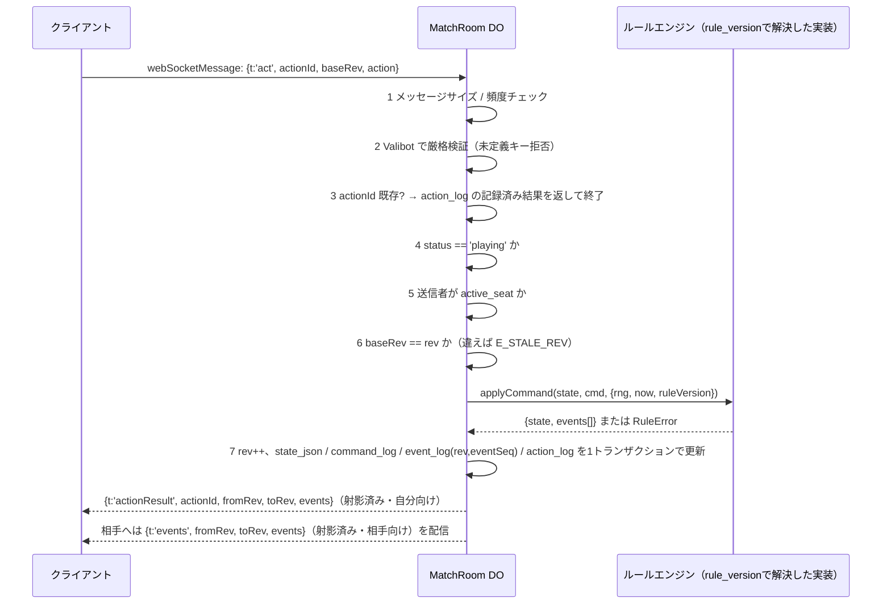
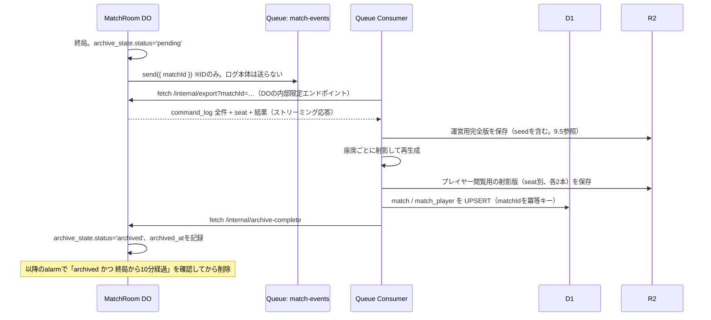
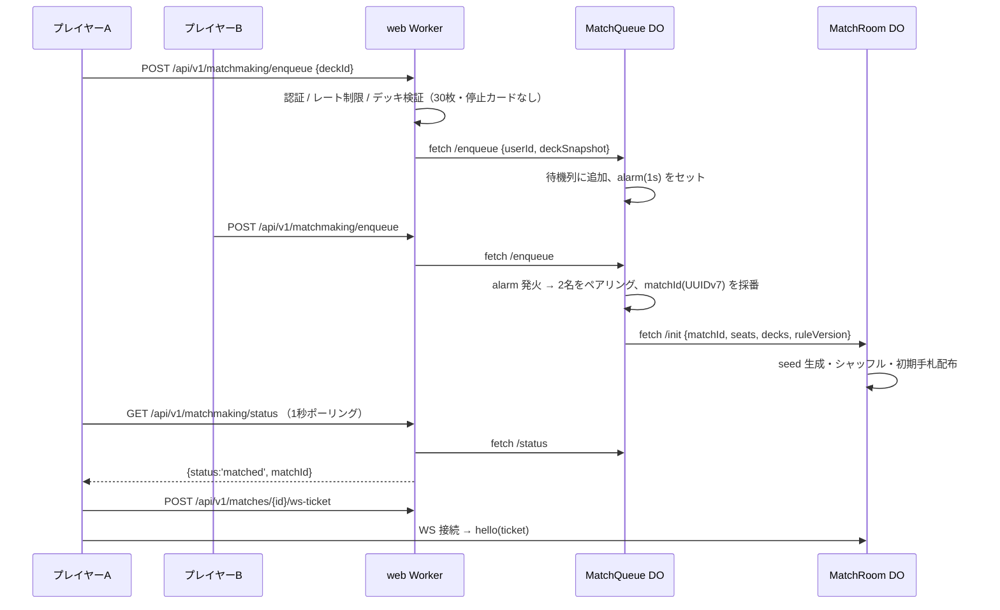

# Durable Objects 設計

> [設計ドキュメント索引](./README.md)


### 9.1 名前空間

| クラス | バインディング | ID の決め方 | 個数 |
|---|---|---|---|
| `MatchRoom` | `MATCH_ROOM` | `idFromName(matchId)` | 1試合につき1つ |
| `MatchQueue` | `MATCH_QUEUE` | `idFromName("<mode>:<bucket>")` | モード×レート帯につき1つ |
| `GuestIssuanceGuard` | `GUEST_GUARD` | `idFromName(ipHash)` | IPハッシュにつき1つ（11.4 / D-29） |

`GuestIssuanceGuard` はロジック上は web Worker の関心事だが、3.2 で述べた `getPlatformProxy` の制約（DO バインディングには `script_name` が必須）はすべての DO に一様に適用されるため、**この DO も realtime Worker に定義**し、web 側からは他の DO と同じく `script_name` 付きで参照する。

`wrangler.jsonc`（realtime）では新方式の `exports` で宣言する。

```jsonc
{
  "durable_objects": {
    "bindings": [
      { "name": "MATCH_ROOM",  "class_name": "MatchRoom" },
      { "name": "MATCH_QUEUE", "class_name": "MatchQueue" },
      { "name": "GUEST_GUARD", "class_name": "GuestIssuanceGuard" }
    ]
  },
  "exports": {
    "MatchRoom":           { "type": "durable-object", "storage": "sqlite" },
    "MatchQueue":           { "type": "durable-object", "storage": "sqlite" },
    "GuestIssuanceGuard":   { "type": "durable-object", "storage": "sqlite" }
  }
}
```

web 側は同じ名前で `script_name` 付きバインディングを持つ。

```jsonc
{
  "durable_objects": {
    "bindings": [
      { "name": "MATCH_ROOM",  "class_name": "MatchRoom",           "script_name": "emerald-wani-realtime" },
      { "name": "MATCH_QUEUE", "class_name": "MatchQueue",          "script_name": "emerald-wani-realtime" },
      { "name": "GUEST_GUARD", "class_name": "GuestIssuanceGuard",  "script_name": "emerald-wani-realtime" }
    ]
  }
}
```

利用する wrangler が `exports` に未対応の場合は legacy の `migrations` 配列で `new_sqlite_classes` を指定する（`exports` と `migrations` は排他）。

### 9.2 MatchRoom（D-17）

**保持する状態（内蔵 SQLite。これが対戦の正）**

```sql
-- 1行のみ。試合のメタ情報と現在状態
CREATE TABLE match_state (
  id            INTEGER PRIMARY KEY CHECK (id = 1),
  match_id      TEXT NOT NULL,
  mode          TEXT NOT NULL,            -- ranked_random | friend | cpu
  rule_version  TEXT NOT NULL,
  seed          BLOB NOT NULL,            -- クライアントへは絶対に送らない
  status        TEXT NOT NULL,            -- waiting | mulligan | playing | finished | void
  rev           INTEGER NOT NULL,         -- 状態リビジョン（単調増加）
  turn_no       INTEGER NOT NULL,
  active_seat   INTEGER NOT NULL,
  state_json    TEXT NOT NULL,            -- MatchState のスナップショット
  started_at    INTEGER,
  ended_at      INTEGER,
  winner_seat   INTEGER,
  end_reason    TEXT
);

-- 参加者
CREATE TABLE seat (
  seat           INTEGER PRIMARY KEY,     -- 0 | 1
  user_id        TEXT NOT NULL,
  deck_snapshot  TEXT NOT NULL,           -- 開始時のデッキ内容（後からの改変不可）
  connected      INTEGER NOT NULL DEFAULT 0,
  grace_until    INTEGER,                 -- 切断猶予の期限
  timeout_streak INTEGER NOT NULL DEFAULT 0
);

-- 受理したCommandの原本（決定論再現に必要な唯一のソース。D-26）
CREATE TABLE command_log (
  rev          INTEGER PRIMARY KEY,       -- 受理したCommand単位で単調増加
  ts           INTEGER NOT NULL,          -- ctx.now に注入した値
  actor_seat   INTEGER,                   -- NULL = システム発行
  command_json TEXT NOT NULL,
  rng_counter  INTEGER NOT NULL,          -- このCommand処理開始時点のRNGカウンタ（9.5）
  rule_version TEXT NOT NULL
);

-- 対戦イベントログ（クライアント配信・プレイヤー向けリプレイの単位。command_log の派生物）
CREATE TABLE event_log (
  rev        INTEGER NOT NULL,
  event_seq  INTEGER NOT NULL,            -- 同一rev内での発生順（0始まり）
  event_json TEXT NOT NULL,
  PRIMARY KEY (rev, event_seq)
);

-- 二重実行対策（企画書 18.2）
CREATE TABLE action_log (
  action_id   TEXT PRIMARY KEY,           -- クライアント生成 UUIDv7
  seat        INTEGER NOT NULL,
  received_at INTEGER NOT NULL,
  base_rev    INTEGER NOT NULL,
  result_rev  INTEGER,                    -- 成功時の確定リビジョン（command_log.rev）
  outcome     TEXT NOT NULL,              -- applied | rejected
  error_code  TEXT
);

-- WSチケットの単回使用保証
CREATE TABLE used_ticket (
  jti     TEXT PRIMARY KEY,
  used_at INTEGER NOT NULL
);

-- 終局後の永続化状態（D-27。Queue consumerとの整合）
CREATE TABLE archive_state (
  id            INTEGER PRIMARY KEY CHECK (id = 1),
  status        TEXT NOT NULL DEFAULT 'pending',  -- pending | archived | failed
  attempts      INTEGER NOT NULL DEFAULT 0,
  last_error    TEXT,
  archived_at   INTEGER
);
```

**なぜ Command を原本とし、Event を派生物とするのか（D-26 の補足）**: `applyCommand` の再現に必要なのは Command 列（と `ctx.now`、RNGカウンタ）だけであり、Event はその実行結果に過ぎない。Event だけを保存してシードから状態を再現しようとすると、Event に含まれない中間判断（どのトリガがどの順で解決されたか等）を失う。`command_log` を正本、`event_log` をクライアント配信・プレイヤー向けリプレイ専用の派生インデックスと位置づけることで、9.5 の決定論的再現性と 13.3 のリプレイが同じ土台に立つ。

**行動処理シーケンス（不正対策の中核）** — 接続確立（3.5）が完了し、`authPending` が解除された後の定常状態



（接続確立時の `hello` 検証シーケンスは 3.5 を参照。realtime Worker はこの図に登場しない — 行動処理はすべて DO 内で完結する。）

`ack` と `events` を別フレームに分けていた当初案は、確定した rev と表示状態がクライアント側でずれる余地があったため、**行動者向けは `actionResult` 1本に統合**した（13.2 で詳述）。

手順3〜7の間に `await` を挟まない（DO SQLite の同期 API を使う）ことで、**行動の直列性と原子性を保証**する。初期化のみ `ctx.blockConcurrencyWhile()` を使う。

**WebSocket（Hibernation API）**

- `this.ctx.acceptWebSocket(server, [tag])` で受け付ける（`server.accept()` は使わない）。アイドル中に DO がメモリから退避され、課金と資源を節約できる。接続直後は `authPending` タグを付け、`hello` 検証成功後に座席タグへ付け替える（`getWebSockets(tag)` で座席ごとに引ける）。
- `webSocketMessage` / `webSocketClose` / `webSocketError` ハンドラで処理する。`addEventListener` は使わない。
- 接続が `authPending` のまま5秒を超えたら `alarm` で強制切断する。
- 接続の同一性は `ws.serializeAttachment({ matchId, seat, userId, connId, authenticated })` で保持する。ハイバネーション復帰後も座席が分かる。
- キープアライブは `ctx.setWebSocketAutoResponse(new WebSocketRequestResponsePair('ping', 'pong'))` で DO を起こさずに応答する。
- **同時接続数**: 1試合1座席あたり **同時に有効な接続は1本のみ**とする。同じ座席から新しい接続が確立され `hello` 検証に成功した時点で、その座席の既存接続があれば `close(4000, 'superseded')` で即座に閉じる（多重タブでの操作競合を避けるため）。

**alarm による時間管理**

`alarm()` は単一のスケジューラとして使い、期限テーブル（ターン期限 / 切断猶予期限 / 試合上限）のうち最も早いものをセットする。発火時は該当するシステム Command を `applyCommand` に流す。

| 期限 | 値 | 発火時の処理 |
|---|---|---|
| ターン期限 | 90秒 | `sys.turnTimeout` → 自動 `endTurn`。3連続で敗北 |
| マリガン期限 | 30秒 | 引き直しなしで確定 |
| 切断猶予 | 60秒 | 期限内に再接続がなければ相手に通知、さらに60秒で `disconnect` 敗北 |
| 試合上限 | 20分 / 25ターン | HP比較で決着 |
| 終局後の永続化開始 | 終局直後（即時） | `archive_state.status='pending'` にし、Queue へ `{ matchId }` を送信。WS はここでは閉じない（結果閲覧のため一定時間維持） |
| 終局後の掃除 | `archive_state.status='archived'` を確認できた後、かつ終局から最短10分 | WS を閉じ、DO の SQLite を削除する。`archived` を確認できない場合は削除せず、9.4 の再試行に委ねる（下記参照） |

**再接続**

1. クライアントは新しい WS チケットを REST で取得する。
2. 接続後の `hello` フレームに `lastRev` を添える。
3. DO は `lastRev` 以降のイベントを `event_log` から送る。差が大きい（例 200 rev 超）または `lastRev` が不明なら、射影済みの **完全スナップショット** を送る。
4. 終局後の DO への接続は結果の閲覧のみ許可し、行動要求はすべて `E_MATCH_FINISHED` で拒否する（企画書 19）。

**終局後の永続化と削除のタイミング（D-27。P0-4 の修正）**

当初案は「終局から10分後に無条件で DO の SQLite を削除する」としていたが、これは consumer が Queue メッセージの処理（R2/D1 への書き込み）に成功した保証がないまま削除する危険を持っていた。加えて、対戦ログ全体を1つの Queue メッセージに詰める案は Cloudflare Queues の **メッセージ上限 128 KB（バッチ全体でも 256 KB）** を超える可能性が高い（[Queues limits](https://developers.cloudflare.com/queues/platform/limits/)）。1試合で数百イベントが発生する前提（12.2）と矛盾する。修正した永続化フローは次のとおり。



- **Queue には `matchId` のみを送る。** ログ本体は consumer が DO の内部限定エクスポート API（`/internal/export`。realtime Worker のサービスバインディング経由でのみ到達可能とし、外部公開しない）から取得する。これにより 128 KB 制限を回避する。
- **R2 は運営用完全版とプレイヤー閲覧用射影版を分けて保存する。** 「ヘッダ（シード）だけ除けばよい」という当初案は誤りで、Event 本体にも相手の手札IDなど秘匿情報が含まれ得るため、**座席ごとに射影し直したものを別ファイルとして保存**する（13.3で詳述）。
- **`archived` を確認できるまで DO の SQLite を削除しない。** consumer が失敗した場合は Cloudflare Queues の自動リトライに委ね、規定回数の失敗で DLQ へ送る。DLQ 滞留中も DO 側は `archive_state.status='failed'` のまま保持され続け、運営が手動で再送するまで削除されない。DO のデータ保持コストとのトレードオフとして、`failed` 状態が **72時間**を超えたら運営へアラートを送る。

### 9.3 CPU 練習戦

CPU 戦も **同じ `MatchRoom` を使う**（`mode = 'cpu'`）。座席1を CPU とし、DO 内で `alarm` により CPU の手番を進める。ルールエンジンを共有するため、対人戦との挙動差が生まれない。CPU 思考は `src/lib/game/ai/` に純粋関数として置く（MVP は「使えるカードを順に出し、有利なトレードを選ぶ」程度のヒューリスティック）。

### 9.4 MatchQueue とマッチング（D-21）



- **明示キャンセル**（`DELETE /matchmaking`）に加え、**lease 方式**で離脱を検出する。`GET /matchmaking/status` の呼び出しごとに待機エントリの `lease_until = now + 20秒` を更新し、`lease_until` を過ぎたエントリは alarm が待機列から除去する。1秒間隔のポーリングを前提にしつつも、一時的な通信の詰まりで即座に列から弾かれないよう猶予を持たせる（当初案の「途絶3秒で除去」は短すぎたため 20秒に修正）。
- **一意制約**: `MatchQueue` は `userId` をキーとして **1ユーザにつき同時に1つの待機エントリのみ**を許可する（既存エントリがあれば新規 `enqueue` は既存を返す＝冪等）。`MatchRoom` 側は `match_state.match_id` を一意キーとし、**1ユーザが同時に `playing` 状態の試合に複数参加できない**ことを試合開始時（`/init`）に確認する。
- **`enqueue` の冪等キー**: リクエストに `requestId`（クライアント生成 UUIDv7）を必須とし、`MatchQueue` は直近の `requestId` を記憶して同一 `requestId` の再送を安全に無視する（二重エントリ防止）。`friend/join` と `matches/cpu` も同様に `requestId` を要求する。
- MVP はレート帯を1つ（`bucket = "all"`）とし、ランク制導入時にバケットを分割する。
- ポーリングは MVP の簡易実装。将来 SSE か WS に置き換える（インタフェース `GET /matchmaking/status` は維持する）。

**フレンド対戦**: web Worker が招待コード（英数8桁・crypto 乱数）を発行し、D1 の `match_invite` に保存する（TTL 15分・単回使用、`used_at` を立てる際は D1 のトランザクション内で存在確認と同時に行い、同じコードの同時使用を防ぐ）。参加者がコードを入力すると同じ `MatchRoom` に着席する。

### 9.5 乱数と ID（D-20 / D-30）

- **試合シード**: `MatchRoom` の初期化時に `crypto.getRandomValues(new Uint8Array(32))` で生成し、SQLite に保存する。**クライアントには決して送信しない**。
- **シャッフル／ランダム効果**: 決定論 CSPRNG として **HMAC-SHA-256 カウンタ方式**（`output_i = HMAC-SHA256(seed, counter_i)` をバイト列として消費し、`counter` を1ずつ進める）を用いて Fisher–Yates を回す。当初案の xoshiro128\*\* は疑似乱数として高速だが暗号学的性質を持たず、内部状態の推測が可能なため対戦ゲームの乱数には不適切（[rand_xoshiro のドキュメント](https://docs.rs/rand_xoshiro/latest/rand_xoshiro/struct.Xoshiro128StarStar.html)も非暗号用途と明記している）。数値への変換は棄却法（rejection sampling）でバイアスを避ける。
- **RNGカウンタの記録**: 各 `command_log` 行に、その Command を処理し始めた時点の `rng_counter` を記録する（9.2）。これにより Command 列を先頭から再実行するだけで、消費した乱数列を含めて完全に決定論的な再現ができる。
- **シードの保管**: 終局後、運営用の完全なリプレイ束（13.3）にのみ含めて R2 に保存する。運営ログとしてのみ参照可能で、API では返さない。
- **ID の指針**: 「推測困難であるべきリソース ID」（対戦ID、デッキID、ユーザID、招待コードの内部キーなど）には **UUIDv7** を用い、連番の AUTOINCREMENT を使わない（企画書 21）。ただしこれは無差別な規約ではない。**カードマスタID**（`CRD_0001` 等）は公開・列挙されて構わない設計上の識別子であり連番で問題ない。**招待コード**（`match_invite.code`）は人が入力する短い文字列であることが要件そのものであり UUIDv7 は使わない（11.5 のとおり英数8桁）。

---
