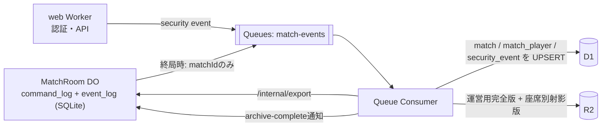

# API とプロトコル

> [設計ドキュメント索引](./README.md)

### 13.1 REST（`/api/v1`）

認証系は better-auth が `/api/auth/*` を担当する。

| メソッド | パス | 認可 | 概要 |
|---|---|---|---|
| GET | `/me` | anonymous+ | 自分の情報・所有状況の要約 |
| GET | `/cards` | anonymous+ | 図鑑（`is_enabled` と所有数を含む） |
| GET | `/decks` | anonymous+ | 自分のデッキ一覧 |
| POST | `/decks` | anonymous+ | 作成（30枚・同名3枚・停止カード不可を検証） |
| GET/PUT/DELETE | `/decks/{id}` | 所有者 | 取得・更新・削除 |
| POST | `/matchmaking/enqueue` | anonymous+ | ランダムマッチ待機開始 |
| DELETE | `/matchmaking` | anonymous+ | 待機キャンセル |
| GET | `/matchmaking/status` | anonymous+ | 待機状況（1秒ポーリング） |
| POST | `/matches/friend` | anonymous+ | 招待コード発行 |
| POST | `/matches/friend/join` | anonymous+ | 招待コードで参加 |
| POST | `/matches/cpu` | anonymous+ | CPU 練習戦の開始 |
| POST | `/matches/{id}/ws-ticket` | 参加者 | WS チケット発行 |
| GET | `/matches` | user | 対戦履歴一覧（自分が参加したもののみ） |
| GET | `/matches/{id}` | 参加者 | 対戦結果詳細 |
| GET | `/matches/{id}/replay` | 参加者 | リプレイ束を認可のうえプロキシ配信 |
| GET | `/announcements` | public | お知らせ |
| POST | `/reports` | user | 通報 |
| — | `/admin/**` | admin | 管理 API（別経路・MFA必須） |

規約は次のとおり。

- バージョンはパスに含める（`/api/v1`）。破壊的変更時に `/v2` を追加し、旧版は移行期間中維持する。
- 機密情報をクエリ文字列に入れない。
- 一覧はカーソルページング（`?cursor=&limit=`）。`limit` 上限50。
- レスポンスに内部 ID・スキーマ名・SQL などを含めない。

**R2 の配信方針**: リプレイは **公開バケットにせず**、Worker が認可後にストリーム配信する。カード画像・音声などの公開アセットのみ、キャッシュ可能な形で配信する。

### 13.2 WebSocket プロトコル

エンドポイント: `wss://<origin>/ws/matches/{matchId}`

**クライアント → サーバ**

| `t` | ペイロード | 備考 |
|---|---|---|
| `hello` | `{ ticket, lastRev? }` | 接続後5秒以内に必須 |
| `act` | `{ actionId, baseRev, action }` | `action` は Command（8.2） |
| `resync` | `{}` | 完全スナップショットを要求 |
| （`ping`） | — | DO の auto-response が `pong` を返す |

**サーバ → クライアント**

| `t` | ペイロード | 備考 |
|---|---|---|
| `welcome` | `{ rev, seat, view, deadlines }` | 射影済みの完全状態。`hello` 検証成功直後に送る |
| `actionResult` | `{ actionId, fromRev, toRev, events: EventBatch[] }` | **自分が送った行動が確定したときのみ**。`ack` と `events` を別フレームにしていた当初案は、確定 rev と表示状態がクライアント側でずれる余地があったため統合した（9.2のP0修正） |
| `events` | `{ fromRev, toRev, events: EventBatch[] }` | **自分の行動に起因しない**更新（相手の行動、システムCommand等）の配信 |
| `error` | `{ actionId?, code, message }` | 下記コード |
| `opponent` | `{ status, graceUntil? }` | 相手の接続状態 |
| `finished` | `{ winnerSeat, endReason, summary }` | 終局 |

`EventBatch` は `{ rev, actorSeat, events: GameEvent[] }`（8.2 の D-26 参照）。クライアントは `toRev` を自身の `MatchStore.rev` に反映し、`fromRev` が現在の `rev + 1` と一致しない場合は自動的に `resync` を送る。

**エラーコード**

`E_MALFORMED` / `E_UNAUTHENTICATED` / `E_FORBIDDEN` / `E_STALE_REV` / `E_NOT_YOUR_TURN` / `E_MATCH_NOT_PLAYING` / `E_MATCH_FINISHED` / `E_CARD_NOT_IN_HAND` / `E_INSUFFICIENT_RESOURCE` / `E_INVALID_TARGET` / `E_LANE_FULL` / `E_RATE_LIMITED` / `E_RULE_VERSION_UNSUPPORTED` / `E_INTERNAL`

`E_STALE_REV` を受けたクライアントは、自動的に `resync` を送って完全同期し直す。

### 13.3 ログ・監査・リプレイ（D-18 / D-19 / D-27）



**永続化の流れは 9.2「終局後の永続化と削除のタイミング」を参照。** 当初案は対戦ログ全体を1つの Queue メッセージに詰めていたが、Cloudflare Queues の**メッセージ上限は128 KB（バッチ全体でも256KB）**であり（[Queues limits](https://developers.cloudflare.com/queues/platform/limits/)）、1試合数百イベントの前提では容易に超過する。修正後は Queue に `matchId` だけを送り、consumer が DO の内部エクスポート API から取得する。

**R2 に保存するファイルの構成（座席別射影版を分離。P0-4修正）**

```
replays/{yyyy}/{mm}/{matchId}/ops.ndjson.gz       -- 運営用完全版
replays/{yyyy}/{mm}/{matchId}/seat0.ndjson.gz     -- 座席0向け射影版（プレイヤー配信用）
replays/{yyyy}/{mm}/{matchId}/seat1.ndjson.gz     -- 座席1向け射影版
```

「ヘッダ（シード）だけ除けばプレイヤーに配信してよい」という当初案は誤りだった。Event 本体にも `cardPlayed` のカードID等、**相手の秘匿情報が座席によって異なる形で含まれる**ため、ヘッダを除いただけでは不十分である。座席別射影版は 8.3 の `projectEvent(event, seat)` を command_log の再実行結果に適用して生成する。

**運営用完全版の形式**（gzip NDJSON。**Command 列が正本**）

```
{"v":1,"matchId":"…","ruleVersion":"2026.09.0","seed":"<base64>","seats":[…],"deckSnapshots":[…],"startedAt":…}
{"rev":1,"ts":…,"actorSeat":0,"command":{…},"rngCounterStart":0,"events":[{"eventSeq":0,"event":{…}},{"eventSeq":1,"event":{…}}]}
{"rev":2,…}
```

- 1行目のヘッダに **シードと初期デッキ** を含み、各行の `command` を先頭から `applyCommand` へ順に投入するだけで盤面を完全再現できる（企画書 34-5）。`events` はデバッグ・監査での参照用に併記するが、**再現の根拠は `command` 列**である（8.2のD-26）。
- シードを含む完全版は運営ログとしてのみ保持し、**プレイヤー向けには座席別射影版（`command` を含まず、射影済み `events` のみ）を配信**する。
- 保持期間: リプレイ（完全版・射影版とも）90日 / 対戦結果 無期限 / セキュリティ監査ログ 400日 / 運営操作履歴 3年 / デバッグログ 7日。

**Queues を使う理由**: 終局時に D1 と R2 へ同期書き込みすると、DO の終局処理が外部 I/O の失敗に引きずられる。Queue に投げることで永続化をリトライ付きで確実に行える。consumer は `matchId` を冪等キーとして UPSERT し、再配信されても二重にならないようにする（企画書 25）。**DO の SQLite は `archive_state.status = 'archived'` を確認できるまで削除しない**（9.2）。

**セキュリティ監査ログの対象**（企画書 23.2 に対応）: ログイン成功／失敗、ログアウト、パスワード変更、メール変更、セッション失効、権限変更、管理者操作、レート制限到達、不正な対戦操作（`E_FORBIDDEN` / `E_NOT_YOUR_TURN` 等の連発）、異常な WS 接続、データエクスポート、アカウント削除。

**ログ保護**: `security_event` / `admin_audit` は API 経由での UPDATE / DELETE 手段を実装しない（追記専用）。保持期間超過分の削除は運用バッチのみが行い、その実行自体も記録する。ログ閲覧も `admin_audit` に記録する。

**ログに出さないもの**: Cookie、パスワード、トークン、チケット、メールアドレス、デッキの中身、手札の内容。

---
