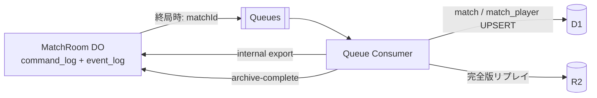

# API とプロトコル

> [設計ドキュメント索引](./README.md)

## 1. REST（`/api/v1`）

認証系は better-auth が `/api/auth/*` を担当する。

| メソッド | パス                      | 認可       | 概要                         |
| -------- | ------------------------- | ---------- | ---------------------------- |
| GET      | `/me`                     | anonymous+ | 自分のプロフィールと戦績要約 |
| POST     | `/matchmaking/enqueue`    | anonymous+ | ランダムマッチ待機開始       |
| DELETE   | `/matchmaking`            | anonymous+ | 待機キャンセル               |
| GET      | `/matchmaking/status`     | anonymous+ | 待機状況                     |
| POST     | `/matches/friend`         | anonymous+ | 招待コード発行               |
| POST     | `/matches/friend/join`    | anonymous+ | 招待コードで参加             |
| POST     | `/matches/cpu`            | anonymous+ | CPU練習戦の開始              |
| POST     | `/matches/{id}/ws-ticket` | 参加者     | WSチケット発行               |
| GET      | `/matches`                | user       | 自分の対戦履歴               |
| GET      | `/matches/{id}`           | 参加者     | 対戦結果詳細                 |
| GET      | `/matches/{id}/replay`    | 参加者     | リプレイを認可後に配信       |
| GET      | `/announcements`          | public     | お知らせ                     |
| POST     | `/reports`                | user       | 通報                         |
| —        | `/admin/**`               | admin      | 管理API（別経路・MFA必須）   |

- API バージョンはパスに含める。
- 機密情報をクエリ文字列に入れない。
- 一覧はカーソルページングとし、`limit` 上限は50とする。
- R2 は公開せず、認可した Worker がリプレイをストリーム配信する。

## 2. WebSocket

エンドポイントは `wss://<origin>/ws/matches/{matchId}` とする。

### クライアントからサーバ

| `t`      | ペイロード                      | 備考                                |
| -------- | ------------------------------- | ----------------------------------- |
| `hello`  | `{ ticket, lastRev? }`          | 接続後5秒以内                       |
| `act`    | `{ actionId, baseRev, action }` | `action` はルールエンジンの Command |
| `resync` | `{}`                            | 射影済み完全スナップショットを要求  |
| `ping`   | なし                            | auto-response が `pong` を返す      |

### サーバからクライアント

| `t`            | ペイロード                             | 備考                         |
| -------------- | -------------------------------------- | ---------------------------- |
| `welcome`      | `{ rev, seat, view, deadlines }`       | 認証直後の状態               |
| `actionResult` | `{ actionId, fromRev, toRev, events }` | 自分の Command の確定結果    |
| `events`       | `{ fromRev, toRev, events }`           | 相手またはシステムによる更新 |
| `error`        | `{ actionId?, code, message }`         | 安定したエラーコード         |
| `opponent`     | `{ status, graceUntil? }`              | 相手の接続状態               |
| `finished`     | `{ winnerSeat, endReason, summary }`   | 終局                         |

`EventBatch` は `{ rev, actorSeat, events: GameEvent[] }` とする。`fromRev` が現在値の次と一致しなければ、クライアントは `resync` する。

主なエラーコードは次のとおり。

`E_MALFORMED` / `E_UNAUTHENTICATED` / `E_FORBIDDEN` / `E_STALE_REV` / `E_WRONG_PHASE` / `E_NOT_YOUR_TURN` / `E_MATCH_FINISHED` / `E_DEPLOYMENT_INVALID` / `E_INSUFFICIENT_VITALITY` / `E_INVALID_MOVE` / `E_INVALID_TARGET` / `E_CELL_OCCUPIED` / `E_ABILITY_UNAVAILABLE` / `E_RATE_LIMITED` / `E_RULE_VERSION_UNSUPPORTED` / `E_INTERNAL`

## 3. 可視性

- `deployment` 中の `view` は相手の配置内容を含めない。
- 相手について送信できるのは布陣確定済みかどうかだけである。
- `deploymentsRevealed` の発行前に、一方の配置を他方へ送ってはならない。
- 公開後は完全情報であり、盤面、全ワニ、捕虜、得点、活力、手番を両者へ同じ内容で配信する。

## 4. ログ、監査、リプレイ



Queue には `matchId` だけを送り、consumer が DO の内部 API からログを取得する。`archive_state = archived` を確認するまで DO の SQLite を削除しない。

リプレイは `replays/{yyyy}/{mm}/{matchId}/match.ndjson.gz` に保存する。

```json
{"v":2,"matchId":"…","ruleVersion":"…","mapVersion":"…","seed":"…","firstSeat":0,"startedAt":0}
{"rev":1,"ts":0,"actorSeat":0,"command":{"type":"submitDeployment","placements":[]},"events":[]}
```

- ヘッダと Command 列を正本とし、Event は監査・表示用の派生物とする。
- 生成盤面と `MAP_VERSION` は布陣開始前から公開する。seed 自体の公開時期はルール詳細で確定する。
- 終局後は布陣も含め完全情報なので、座席別リプレイを分離しない。
- 保持期間はリプレイ90日、対戦結果無期限、セキュリティ監査ログ400日、運営操作履歴3年、デバッグログ7日とする。
- Cookie、パスワード、認証トークン、WSチケット、メールアドレス、布陣公開前の相手配置をログへ出さない。
